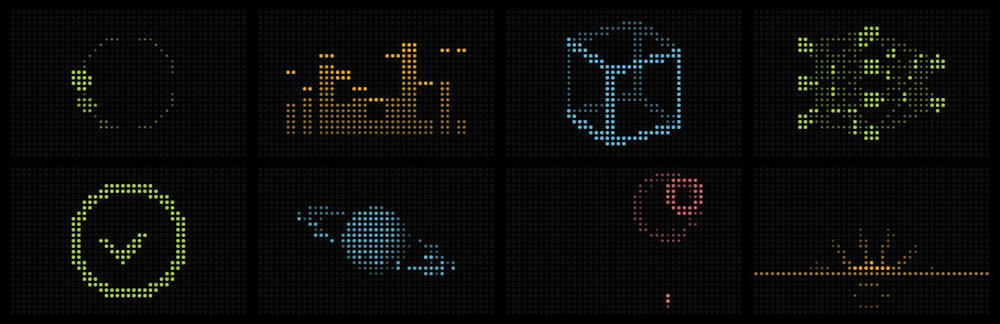

# Elroot Dot Matrix



Dot-matrix animations for the web, drawn on a `<canvas>`: loaders, signals, 3D shapes, LED text, weather, space, celebrations and backgrounds. This repository holds the free arts, the small renderer that draws them, and nothing else: no dependencies, no build step, no network requests.

Browse every art with a live preview at https://elrootlabs.com/opensource/dotmatrix.

## Use an art

Copy `src/` into your project, then mount an art on a canvas:

```html
<canvas id="loader" style="display: block; width: 120px; aspect-ratio: 1"></canvas>
<script type="module">
  import { arts, mountDots } from './src/index.mjs'

  const art = arts['chase-ring']
  mountDots(document.getElementById('loader'), art.default, { color: '#FFB000', autoSpacing: true }, art.prepare)
</script>
```

In React:

```jsx
import { useEffect, useRef } from 'react'
import { arts, mountDots } from './dotmatrix/src/index.mjs'

export function Dots({ id, className, ...options }) {
  const ref = useRef(null)
  const key = JSON.stringify(options)
  useEffect(() => {
    const dots = mountDots(ref.current, arts[id].default, JSON.parse(key), arts[id].prepare)
    return () => dots.destroy()
  }, [id, key])
  return <canvas ref={ref} className={className} aria-hidden="true" />
}
```

`mountDots` returns `{ update(options), destroy() }`. The canvas takes the size its CSS gives it and redraws when that changes.

## Options

| Option | Default | Range | What it does |
|---|---|---|---|
| `color` | `#A6E22E` | hex colour | Colour of the lit dots |
| `color2` | none | hex colour | Colour of the dimmest dots; brightness blends from it to `color` |
| `background` | transparent | hex colour | Fills the area behind the dots |
| `grid` | `true` | | A faint ring at every dot position, light on a dark page and dark on a light one; it follows theme switches |
| `speed` | `1` | 0 to 3 | 0 holds the art still |
| `spacing` | `8` | pixels | Distance between dots; smaller is denser |
| `size` | `1` | | Dot size |
| `shape` | `round` | `round`, `square` | Dot shape |
| `play` | `true` | | `false` holds a still frame |
| `autoSpacing` | `false` | | On a canvas under 360 px, brings the dots closer (down to 3 px apart) so a small art keeps its shape |

Marquee takes `text`, Clock takes `hour12`.

## The arts

42 arts in 12 groups.

**Loaders & progress**: Packet Pipeline (`pipeline`), Chase Ring (`chase-ring`), Hop Trio (`hop-trio`)

**Signals & waves**: Scope Wave (`wave`), Heartbeat Line (`pulse`), Ripple (`ripple`), Radar Sweep (`radar`), Equaliser (`equaliser`)

**Geometry & 3D**: Turning Cube (`cube`), Merging Rings (`merge`), Spiral (`spiral`), Lissajous (`lissajous`)

**Generative patterns**: Plasma (`plasma`), Truchet Tiles (`truchet`)

**Tech & data**: Network (`network`), Neural Net (`neural`), Database (`database`), Chip (`chip`), Rising Bars (`bars`), Layers (`layers`), App Window (`window`), Gear (`gear`)

**Interface & status**: Shield Scan (`shield`), Typing Bubble (`message`), Checklist (`checklist`), Done Tick (`done-tick`), Upload (`upload`)

**Type & LED signs**: 404 (`notfound`), Typing Page (`pages`), Marquee (`marquee`), Clock (`clock`)

**Nature & weather**: Rainfall (`rainfall`), Sunrise (`sunrise`)

**Space**: Orbit Core (`orbit`), Ringed Planet (`ringed-planet`), Comet (`comet`)

**Particles & physics**: Fireflies (`fireflies`), Pendulum Wave (`pendulum-wave`)

**Celebrations**: Fireworks (`fireworks`), Heart (`heart`)

**Backgrounds**: Warp Stars (`warp-stars`), Breathing Grid (`breathing-grid`)

`catalog.json` lists each art with its category, the shape it is drawn for and a line on what it shows.

## Performance and accessibility

Each art draws at most 30 frames a second, groups its dots into eight brightness levels and draws each level in one go, and stops while it is off screen. People who ask their system for reduced motion see one still frame. The canvas is decorative: give it `aria-hidden="true"`, and put any meaning (such as "Loading") in text.

## More arts, and AI assistants

Elroot Dot Matrix has more arts at https://elrootlabs.com/opensource/dotmatrix. AI assistants can add any of them to a project through the MCP server at https://elrootlabs.com/mcp.

## Try it locally

Serve the folder with any static web server and open `examples/index.html`, which shows every art.

## Licence

MIT. See [LICENSE](LICENSE). Keep the licence note when you copy the files.

## Contributing and security

See [CONTRIBUTING.md](CONTRIBUTING.md). Report security problems privately, as described in [SECURITY.md](SECURITY.md).
